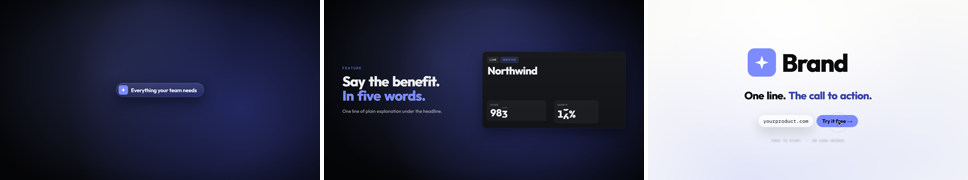

# MOTION-STUDIO: a motion-graphics studio run by Claude

Claude makes professional motion-graphics ads and explainers for **your product** as code
(Remotion), renders them, checks its own frames and fixes them until they're good. Every
video comes out in **16:9** (YouTube) and **9:16** (Reels / TikTok / Shorts) from the same timeline.

## 1. Install once (Windows, about 20 minutes)
1. **Claude Code** with a paid Claude plan. Use the VS Code extension or the desktop app:
   https://claude.com/claude-code
2. **Git**: https://git-scm.com/download/win (keep the defaults; this also gives you Git Bash).
3. **Node.js** LTS: https://nodejs.org
4. **Python 3.11+**: https://www.python.org/downloads/ (tick "Add python.exe to PATH").
5. **ffmpeg**: open PowerShell and run `winget install Gyan.FFmpeg`.
6. Optional: **rubberband** (used to fit songs to the beat). Download the Windows build from
   https://breakfastquay.com/rubberband/ and put `rubberband.exe` on your PATH, or ask Claude
   to do it for you.

Then get your copy of this repo. On GitHub, click **Use this template → Create a new repository**
(make it private), then in VS Code: **Clone Git Repository** → pick your new repo.

Open the folder in Claude Code and say:

> Set up this studio on my PC: run scripts/setup.sh, install anything missing, then render
> the Template stills so I can see it works.

Claude installs the packages (`npm ci`, `pip install -r requirements.txt`, the headless
browser) and shows you three stills like the picture above.

## 2. Make it yours (once, about 15 minutes with Claude)
Say:

> Set up the brand for my product: https://myproduct.com

Claude reads your site, captures it, fills in `videos/BRAND.md` (your product, messages,
audience), sets your colours and fonts in `src/kit/theme.ts` and asks you for your logo
(a white SVG of the mark). You check the result on the Template end card.

## 3. Make a video
1. Say what you want, e.g. *"next video: a 30 s ad for our new dashboard"* or
   *"explain how onboarding works, with voice-over"*.
2. Claude proposes 2-3 style references, then 3 storyboard ideas, then writes the **script**
   (a table: time, what you see, voice line). Nothing is built until you say OK.
3. Claude writes a **Suno** music brief. You make the song in Suno and drop the WAV in the
   chat or in `public/<film>/song.wav`.
4. Optional: Claude writes Gemini/Veo prompts for photographic backgrounds; you generate them.
5. Voice-over films: record the lines (any tool, or your own voice) as one WAV.
6. Claude builds the 16:9 version, checks it frame by frame, and shows you previews.
   Give notes; Claude fixes them.
7. Claude syncs every cut to the beat of your song, adds sound effects, mixes to the Instagram /
   YouTube loudness standard and delivers the final MP4 in `out/<film>/`. Once you lock 16:9,
   the 9:16 version follows.

Good to know:
- Use effort **xhigh** for new films (`/model` → effort), medium for small fixes.
- `npm run studio` opens a live preview of every film in the browser.
- Finished MP4s live in `out/` (not saved to GitHub). Keep the ones you post.
- Every decision you make gets written into `videos/BRAND.md`, so Claude never asks twice.

## What's inside (for Claude)
Start with `CLAUDE.md` (house rules + workflow), then `videos/BRAND.md` (product + owner
decisions), the `/studio-video` skill (step by step) and `/studio-house` (motion tokens,
transitions, review checklist).

## Licences
- Remotion is free for individuals and companies of up to 3 people; bigger companies need a
  company licence (https://remotion.pro).
- Fonts in `public/fonts/` are open-licence (OFL, files included).
- Third-party skills in `.claude/skills/` come from their public repos (`skills-lock.json`).
- Community prompts in `prompts/community/` are stored with credit to their authors.
- Music, voice and generated images: you're responsible for the terms of the tools you use.
